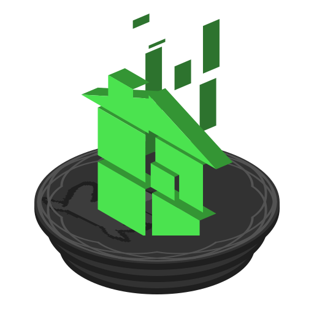

<div align="center">



# @homestuck/platform


<a href="https://discord.gg/homestuck" target="_blank"></a>
<a href="https://x.com/homestuck" target="_blank"></a>
<a href="https://bsky.app/profile/homestuck.com" target="_blank"></a>
</div>

## About This Repository

The `@homestuck/platform` repository is a monorepo workspace for shared configurations, published
packages, and applications maintained by Homestuck Inc., et al. It provides reusable assets, styles,
UI components, and configuration for projects within the _Homestuck_ and broader _MSPaintAdventures_
ecosystems.

## What's Included

The following [`@homestuck`](https://github.com/homestuck) scoped packages are included in this
monorepo:

### Tooling

- [`@homestuck/oxfmt-config`](./packages/oxfmt-config) — Shared Oxfmt configuration for consistent
  formatting.
- [`@homestuck/oxlint-config`](./packages/oxlint-config) — Shared Oxlint configurations for
  consistent linting.
- [`@homestuck/tsconfig`](./packages/tsconfig) — Shared TypeScript compiler configurations.

### Packages

- [`@homestuck/assets`](./packages/assets) — Reusable shapes, symbols, and fonts.
- [`@homestuck/env`](./packages/env) — T3-Env environment variable schemas and validations.
- [`@homestuck/styles`](./packages/styles) — CSS and Tailwind CSS styles.
- [`@homestuck/tokens`](./packages/tokens) — Design Token Community Group specification-compliant
  tokens.
- [`@homestuck/types`](./packages/types) — Shared Typescript type definitions for workspace
  packages.
- [`@homestuck/ui`](./packages/ui) — Shared React UI components, blocks, hooks, and component
  styles.
- [`@homestuck/utils`](./packages/utils) — Shared utility function library for workspace packages.

### Apps

- [`@homestuck/design-system`](./apps/design-system) — Design system documentation website powered
  by Storybook.js.

## Getting Started

### System Requirements

For local development, install the following tools:

- [pnpm](https://pnpm.io/) `>=12.x`
- [Node.js](https://nodejs.org/) `>=24.10.x`

You can use the repository's [Dev Container](./.devcontainer) instead of installing Node.js and pnpm
on your host. The Dev Container requires [Docker](https://www.docker.com/) and the
[Dev Containers extension for VS Code](https://marketplace.visualstudio.com/items?itemName=ms-vscode-remote.remote-containers).

### Local Development

Once cloned into the repository, install dependencies with pnpm:

```sh
pnpm install
```

### Dev Container

1. Install Docker and the Dev Containers extension for VS Code.
2. Open the repository in VS Code.
3. Run `Dev Containers: Reopen in Container` from the Command Palette.
4. Wait for the container to finish running `pnpm install`.

The container uses Node.js 24 and pnpm 12 and mounts the repository into the workspace.
